# T120 Bench

A browser tool for the 2018 Triumph Bonneville T120 (liquid-cooled). It reads live engine data from an OBD-II adapter, finds faults with sourced checks and shows where the part is on the bike, times acceleration, and rehearses ECU writes on a digital twin before anything touches the bike.

## Open it

**https://jsankr.github.io/T120-Bench/**

> **Simulated data is labelled.** Until an adapter is connected, everything you see comes from a digital twin model, and an amber "SIMULATED DATA" strip sits at the top. The strip disappears only when a real ECU answers.

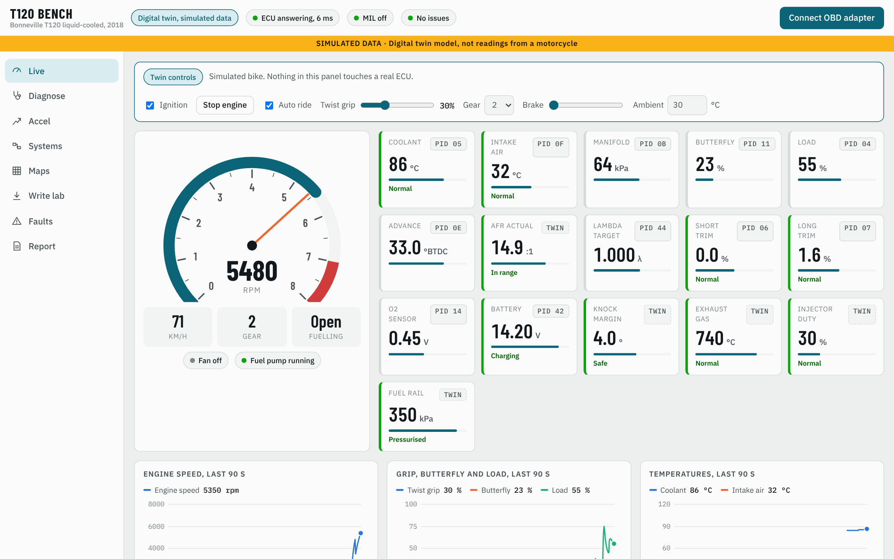

## Which connection works where

| Device and browser | Bluetooth LE adapter | WiFi adapter |
|---|---|---|
| Windows, macOS, ChromeOS, Linux: Chrome or Edge | Yes | Yes, through the bridge on that laptop |
| Android: Chrome | Yes | Yes, through the bridge on a laptop |
| iPhone / iPad: Bluefy browser | Yes | Yes, through the bridge on a laptop |
| iPhone / iPad: Chrome, Safari, Firefox | No (Apple's engine has no Web Bluetooth) | Yes, through the bridge on a laptop |
| Any phone or laptop, Firefox | No | Yes, through the bridge |

- The adapter must be an ELM327-compatible **Bluetooth Low Energy** type. Classic Bluetooth adapters cannot be reached from any browser.
- WiFi adapters use a raw TCP connection that no browser can open, so a small relay (`tools/t120-wifi-bridge.js`) runs on a laptop.

## Connect from a laptop

### Bluetooth LE adapter (Chrome or Edge)

1. Plug the adapter into the bike's diagnostic connector. Ignition on, kill switch to RUN, engine off. Wait for the adapter's light.
2. Turn the laptop's Bluetooth on. Do not pair the adapter in the operating system's settings; the browser picks it.
3. Open **https://jsankr.github.io/T120-Bench/** in Chrome or Edge.
4. Click **Connect OBD adapter**, then **Connect over Bluetooth**.

   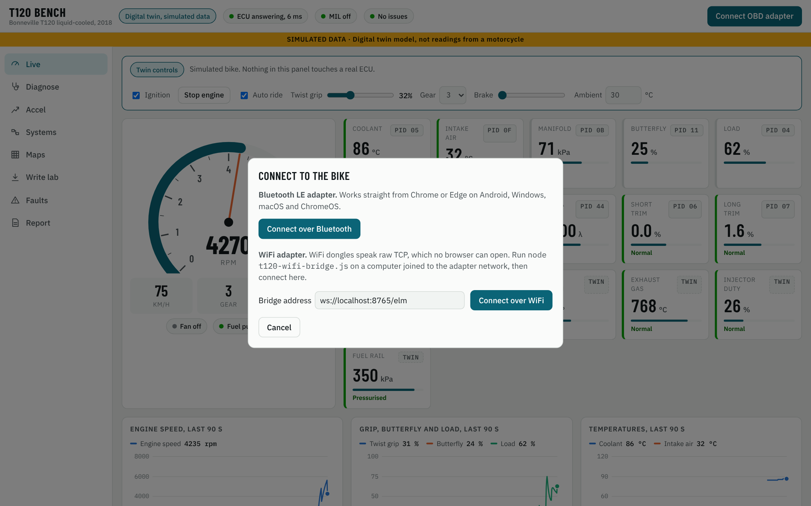

5. Pick your adapter in the browser's device list and click **Pair**.
6. Wait a few seconds. The header changes to **Live ECU · Bluetooth**, the amber strip disappears and the tiles fill with ECU data. Tiles the ECU does not publish show "Not on standard OBD".

   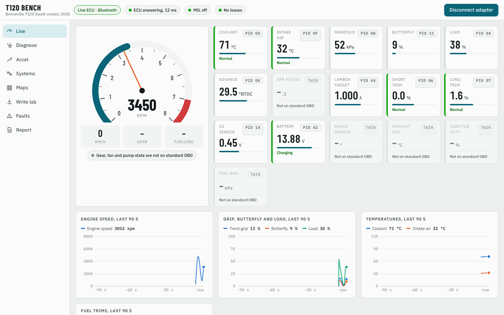

7. Open **Faults** to see the VIN, protocol and which data the ECU publishes.

   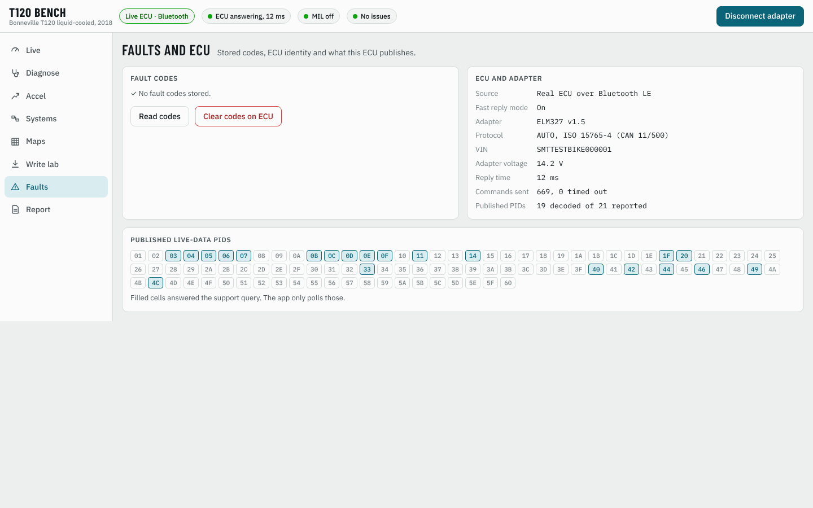

To disconnect, click **Disconnect adapter**. If the link drops, the app returns to the twin and the amber strip comes back.

### WiFi adapter (any browser)

1. Install Node 16 or newer on the laptop. Download this repository (green **Code** button, **Download ZIP**) and unzip it.
2. Plug the adapter into the bike. Ignition on, engine off.
3. Join the laptop to the adapter's WiFi network (often named like `WiFi_OBDII`).
4. In a terminal in the unzipped folder run:

   ```bash
   node tools/t120-wifi-bridge.js
   ```

   If your adapter is not at the common address `192.168.0.10:35000`, add `--adapter <ip>:<port>`.
5. Open **http://localhost:8765/** in the browser. The bridge serves the app itself.
6. Click **Connect OBD adapter**. The bridge address is filled in; click **Connect over WiFi**.

   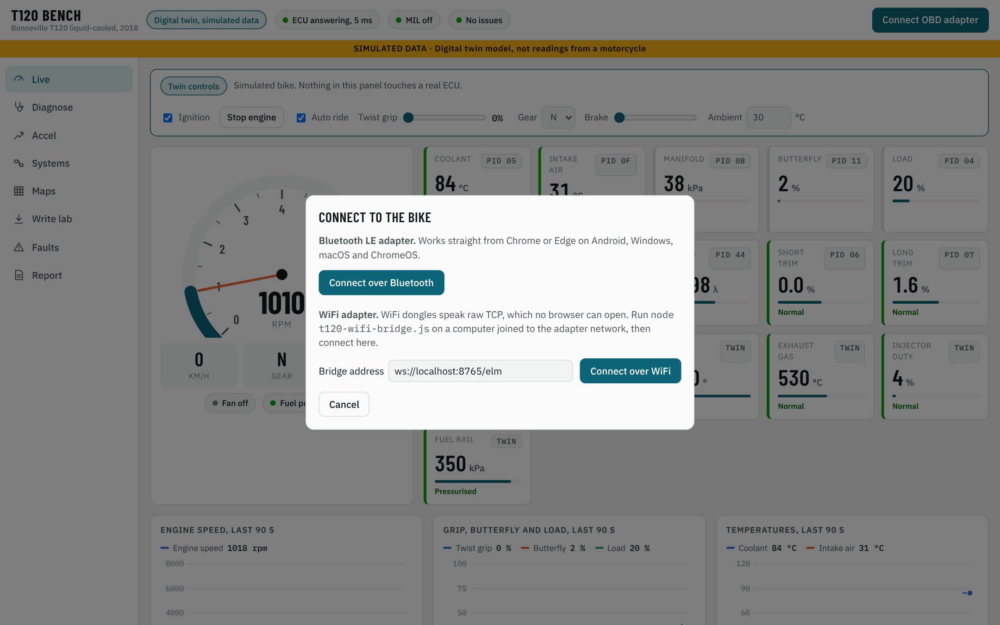

7. The header changes to **Live ECU · WiFi**.

   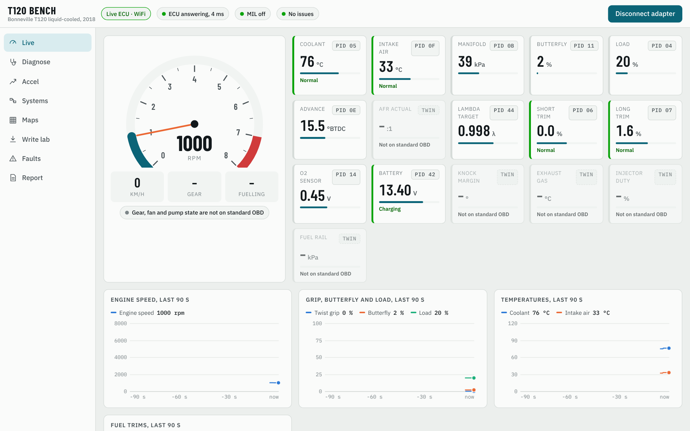

## Connect from a phone

### Android with a Bluetooth LE adapter (Chrome)

1. Plug in the adapter, ignition on, engine off.
2. Turn on Bluetooth and Location on the phone. Chrome needs the Nearby devices permission the first time.
3. Open **https://jsankr.github.io/T120-Bench/** in Chrome.
4. Tap **Connect OBD adapter**, then **Connect over Bluetooth**, pick the adapter, tap **Pair**.

   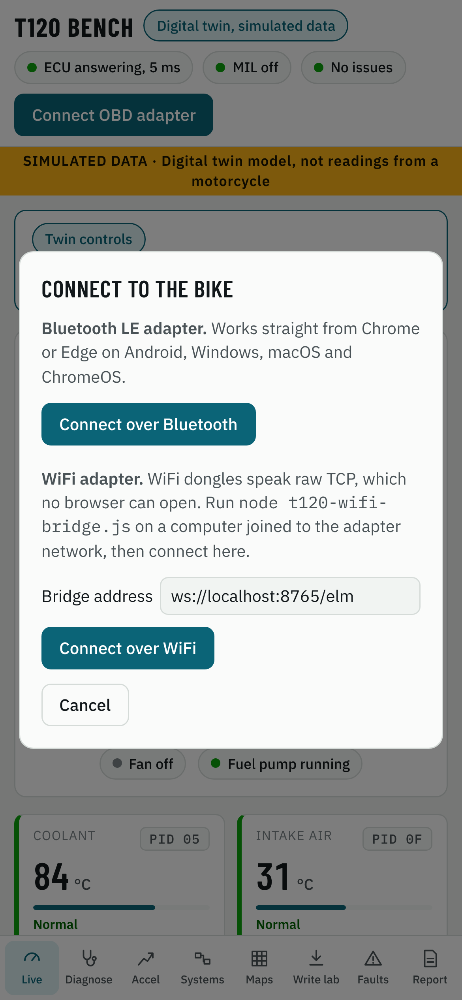

5. The header shows **Live ECU · Bluetooth**.

   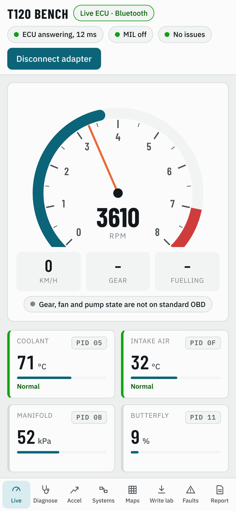

### iPhone or iPad with a Bluetooth LE adapter (Bluefy)

1. Install the free **Bluefy – Web BLE Browser** from the App Store.
2. Open **https://jsankr.github.io/T120-Bench/** in Bluefy and allow Bluetooth when asked.
3. Follow steps 4 and 5 of the Android steps.

Chrome, Safari and Firefox on iPhone cannot use Bluetooth adapters. They open the app on the twin and explain why:

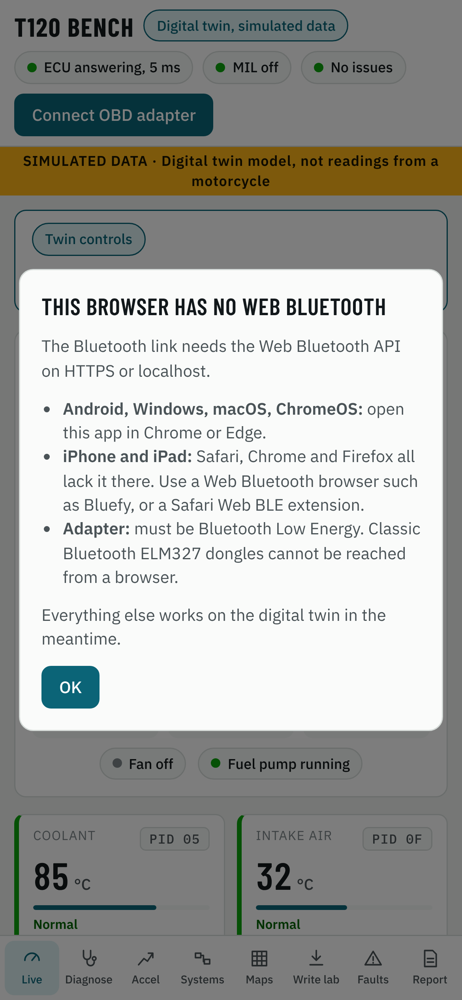

### Any phone with a WiFi adapter (through a laptop)

1. On the laptop, join the adapter's WiFi network and run:

   ```bash
   node tools/t120-wifi-bridge.js --lan
   ```

2. Note the laptop's IP address on that network (for example `192.168.0.11`).
3. Join the phone to the same adapter WiFi network.
4. Open `http://192.168.0.11:8765/` (your laptop's IP) in any browser. On iPhone, allow the local network prompt.
5. Tap **Connect OBD adapter**, then **Connect over WiFi**.

    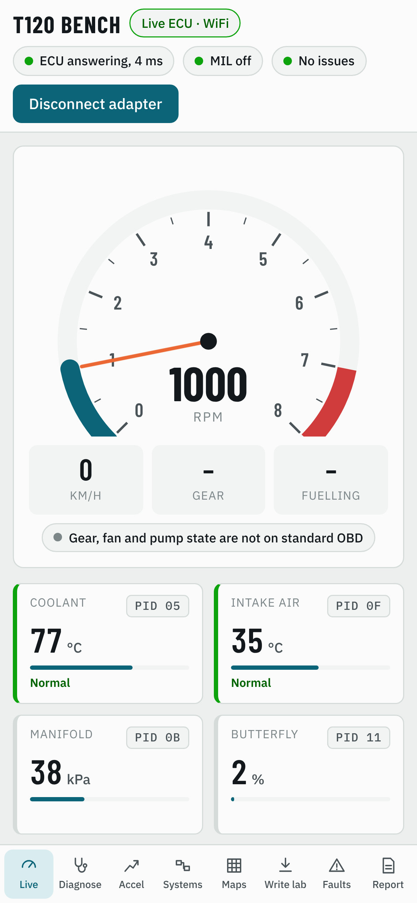

Some cheap WiFi adapters accept only one device. If the phone and the laptop cannot both join, use a Bluetooth LE adapter instead.

## What it does

| Section | What you get |
|---|---|
| Live | Tachometer, live tiles with status, 90-second charts |
| Diagnose | Continuous checks, five guided tests, alerts, fix steps, part locations on a schematic, every claim tagged with its source |
| Accel | 0–60, 0–100, 60–100 and 80–120 km/h timing from the road-speed signal, with timing uncertainty shown |
| Systems | Every channel by system, marking which come from the ECU and which exist only in the twin |
| Maps | Fuel, ignition, throttle and limit tables of the twin, safety checks, virtual dyno |
| Write lab | Backup, checks, pre-flight and a full write rehearsal on the twin, including link-drop and low-voltage failures and recovery |
| Faults | Read and clear fault codes, ECU and adapter details |
| Report | CSV, JSON and HTML exports |

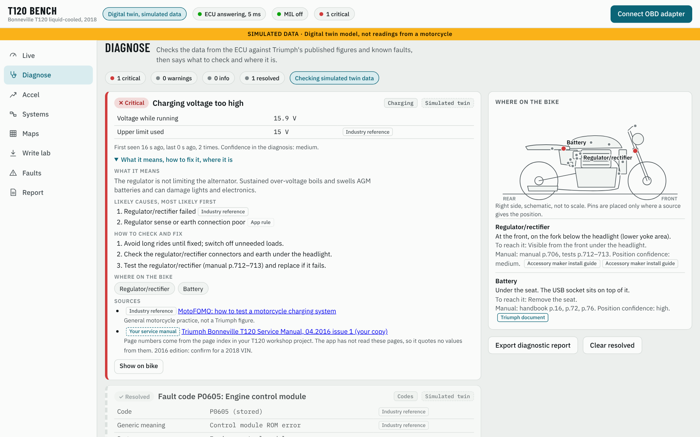

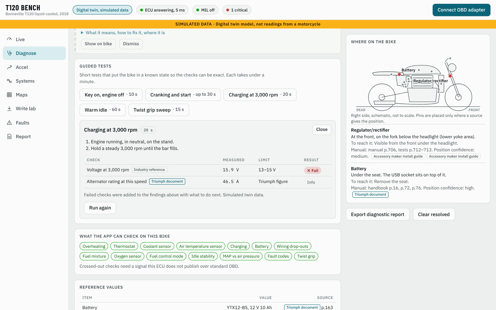

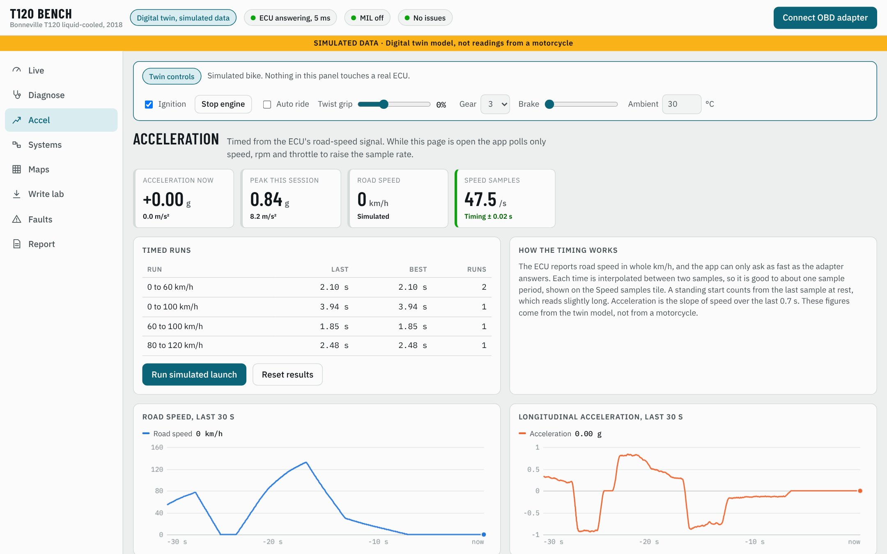

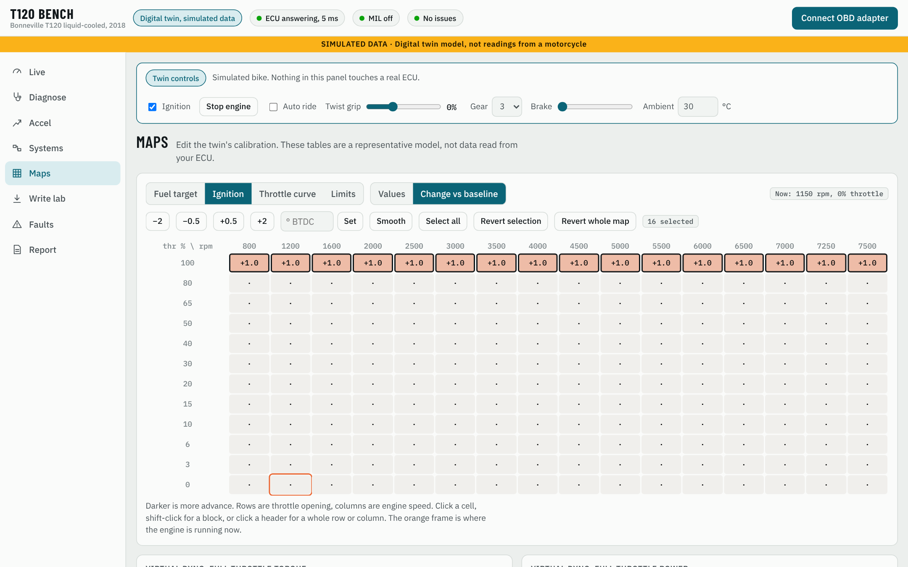

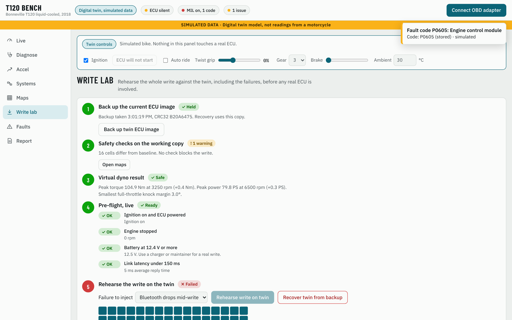

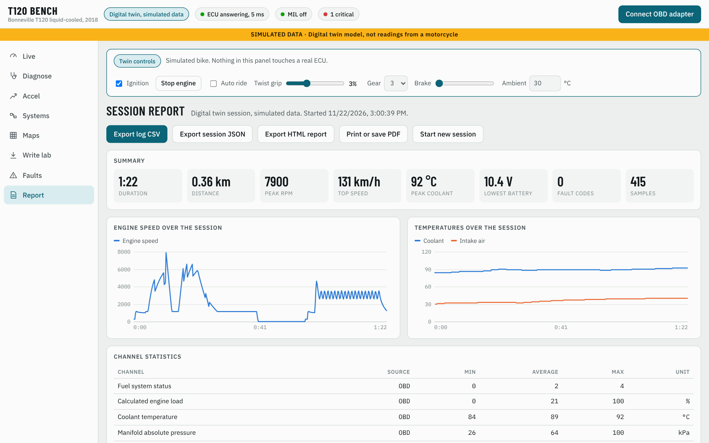

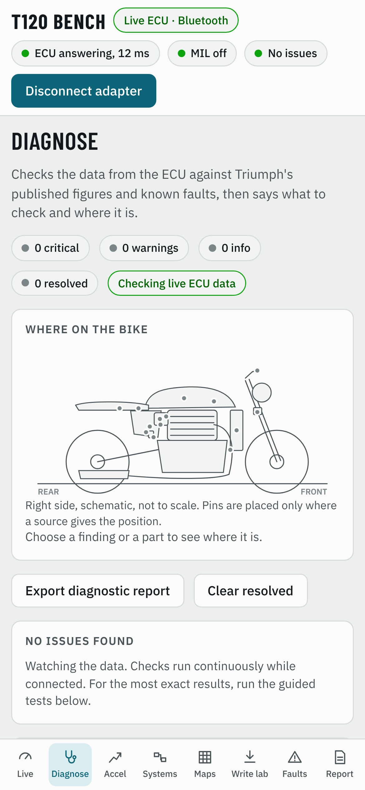

**About the screenshots:** they were captured from this build in headless Chrome. Screens marked "Live ECU" were connected to test adapters (a fake Bluetooth LE adapter and a fake WiFi adapter) backed by a separate simulated bike, not to a motorcycle. Values in them are simulated.

## What it does not do

- **It does not write maps to a real ECU.** The T120 Keihin flash protocol is proprietary and not implemented here; real writes are limited to clearing fault codes.
- **The map tables are a model, not Triumph calibration data.**
- **Some Triumph values are not in the app** (idle speed, fuel pressure, fan switch-on temperature, sensor resistances). The Diagnose page lists the service manual pages to check, and lets you enter your own figures.
- Only data the ECU publishes over standard OBD-II is shown live. Channels it does not publish are marked, never filled in.

## Sources

Diagnostic checks use Triumph's owner's handbook and technical bulletins (public NHTSA copies), page references from the 2016 service manual, accessory maker install guides, and general OBD and battery references. Each finding names its sources and their type. Where no Triumph figure was available, the threshold is marked as an app rule.

## Tests and reports

| Report | What it is |
|---|---|
| [Test report (HTML)](https://jsankr.github.io/T120-Bench/reports/test-report.html) · [Markdown](reports/test-report.md) | Every check from every suite, with environment and scope |
| [Sample session report](https://jsankr.github.io/T120-Bench/reports/samples/SIMULATED-t120-report.html) | The app's HTML session export, from the twin |
| [Sample diagnostic report](https://jsankr.github.io/T120-Bench/reports/samples/SIMULATED-t120-diagnosis.html) | The Diagnose export, with a simulated charging fault |
| [Sample log CSV](reports/samples/SIMULATED-t120-log.csv) · [Sample session JSON](reports/samples/SIMULATED-t120-session.json) | Raw exports from the same twin run |

Latest run, 22 Nov 2026: **187 of 187 checks passed** (47 logic tests, 140 headless-browser checks). **No test has used a real adapter, ECU or motorcycle**; the Bluetooth and WiFi paths were tested against fake adapters backed by a simulated bike.

Run them yourself (needs Node 16+, Python 3 and `pip install playwright`):

```bash
node tests/test.js                      # protocol, twin, flash rehearsal, acceleration
node tests/diagtest.js                  # diagnostic rules against simulated faults
python tests/run_all.py                 # everything, including headless Chrome, and writes reports/
python tests/browser/screenshots.py     # regenerates docs/screenshots and reports/samples
```

`index.html` is a single self-contained file built from `src/` with `node src/build.js`.

## Safety

Diagnostic output is guidance, not a workshop verdict. Confirm values against your own service manual before repair, and stop riding if the app or the instruments show a critical warning.

## Licence

MIT, see [LICENSE](LICENSE).
